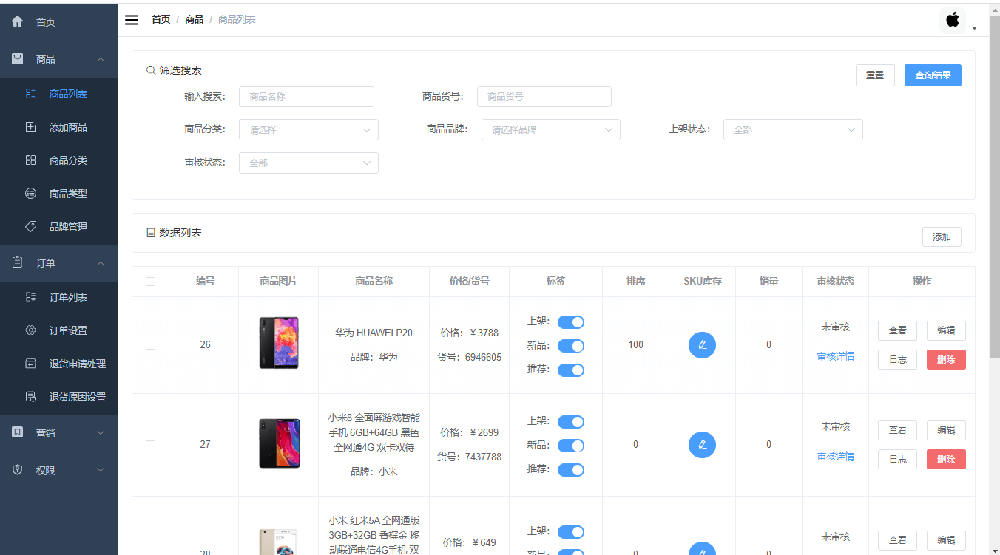
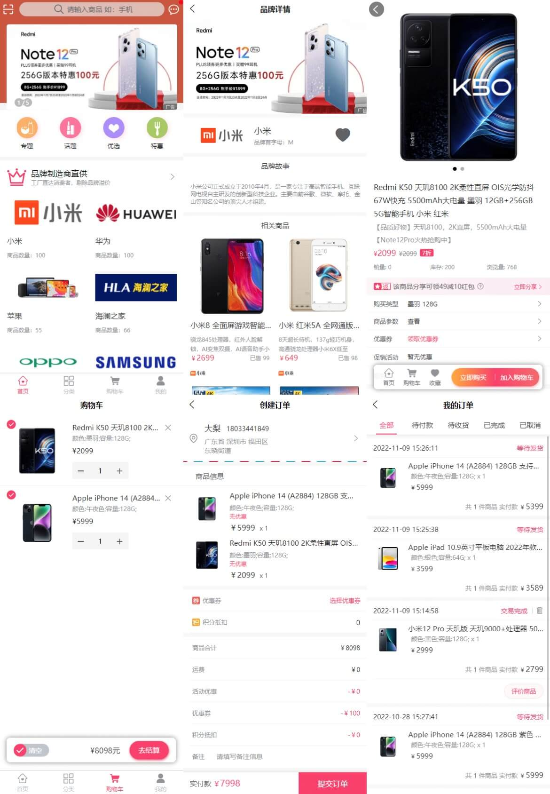
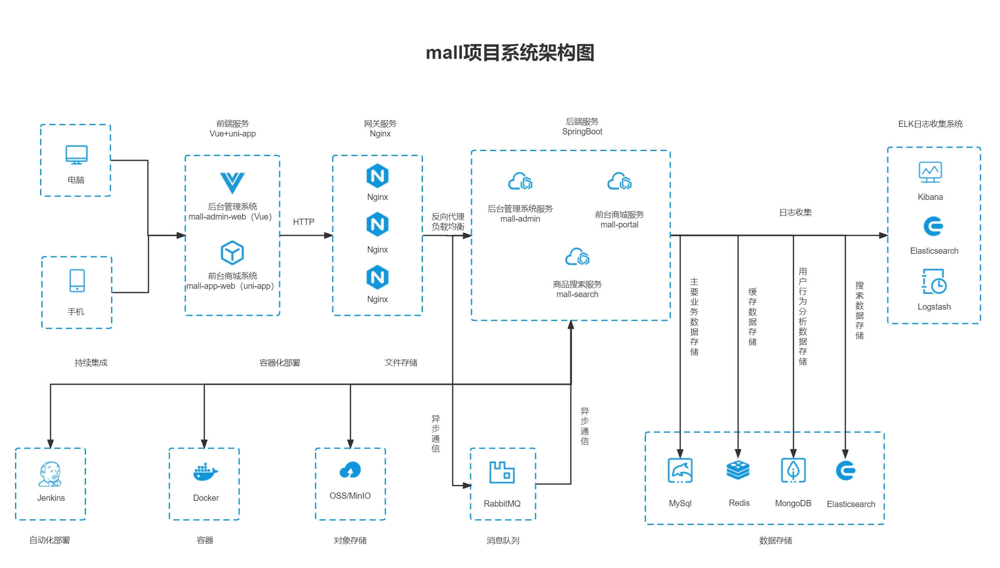
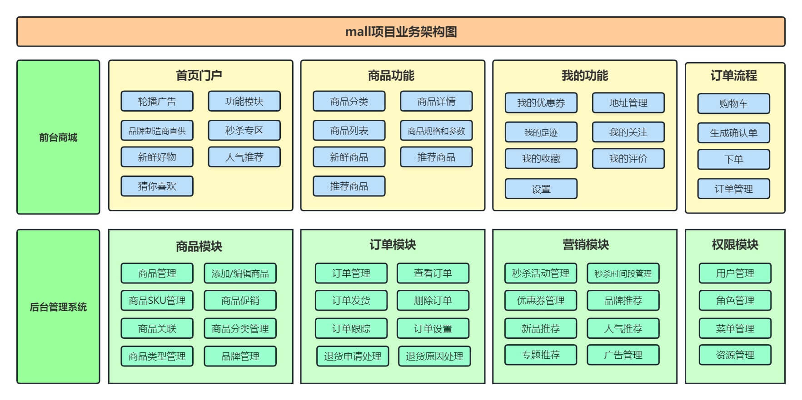
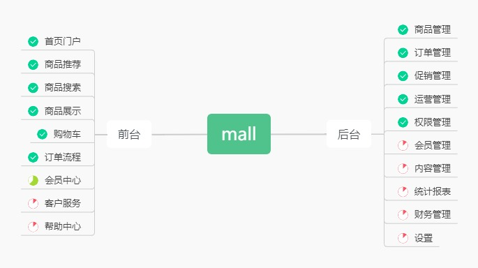

# mall

<p>
  <a href="#공식 계정"></a>
  <a href="#공식 계정"></a>
  <a href="https://github.com/macrozheng/mall-learning"></a>
  <a href="https://github.com/macrozheng/mall-swarm"></a>
  <a href="https://github.com/macrozheng/mall-admin-web"></a>
  <a href="https://github.com/macrozheng/mall-app-web"></a>
  <a href="https://gitee.com/macrozheng/mall"></a>
</p>

## 안내

> 1. **빠른 체험 프로젝트**: [온라인 접속 주소](https://www.macrozheng.com/admin/index.html) .
> 2. ****전체 학습 튜토리얼**: [mall 학습 튜토리얼](https://www.macrozheng.com) .
> 3. **동영상 강의**: [mall 동영상 강의](https://www.macrozheng.com/mall/catalog/mall_video.html) .
> 4. **마이크로서비스 버전**: Spring Cloud Alibaba 기반 프로젝트: [mall-swarm](https://github.com/macrozheng/mall-swarm) .
> 5. **브랜치 설명**:`master`브랜치는 Spring Boot 3.5+JDK 17 기반이며,`dev-v2`브랜치는 Spring Boot 2.7+JDK 8 기반입니다.

## 머리말

`mall`이 프로젝트는 현재 주류 기술로 완성도 높은 이커머스 시스템을 만드는 것을 목표로 합니다.

## 프로젝트 문서

문서 주소:[https://www.macrozheng.com](https://www.macrozheng.com)

## 프로젝트 소개

`mall`이 프로젝트는 프런트 쇼핑몰 시스템과 관리자 시스템을 포함한 이커머스 시스템으로, SpringBoot+MyBatis 기반으로 구현했고 Docker 컨테이너로 배포합니다. 프런트 쇼핑몰 시스템은 홈 포털, 상품 추천, 상품 검색, 상품 전시, 장바구니, 주문 프로세스, 회원 센터, 고객 서비스, 도움말 센터 등의 모듈을 포함합니다. 관리자 시스템은 상품 관리, 주문 관리, 회원 관리, 프로모션 관리, 운영 관리, 콘텐츠 관리, 통계 리포트, 재무 관리, 권한 관리, 설정 등의 모듈을 포함합니다.

### 프로젝트 데모

#### 관리자 시스템

프런트엔드 프로젝트`mall-admin-web`주소:https://github.com/macrozheng/mall-admin-web

프로젝트 데모 주소: [https://www.macrozheng.com/admin/index.html](https://www.macrozheng.com/admin/index.html)  



#### 프런트 쇼핑몰 시스템

프런트엔드 프로젝트`mall-app-web`주소:https://github.com/macrozheng/mall-app-web

프로젝트 데모 주소(브라우저를 모바일 모드로 전환하면 더 좋습니다):[https://www.macrozheng.com/app/](https://www.macrozheng.com/app/)



### 조직 구조

```
mall
├── mall-common -- 유틸리티 클래스 및 공통 코드
├── mall-mbg -- MyBatisGenerator생성된 데이터베이스 작업 코드
├── mall-security -- SpringSecurity공용 모듈 래핑
├── mall-admin -- 쇼핑몰 관리자 시스템 API
├── mall-search -- Elasticsearch 기반 상품 검색 시스템
├── mall-portal -- 프런트 쇼핑몰 시스템 API
└── mall-demo -- 프레임워크 구성 시 테스트 코드
```

### 기술 선정

#### 백엔드 기술

| 기술                 | 설명                | 공식 사이트                                           |
| -------------------- | ------------------- | ---------------------------------------------- |
| SpringBoot           | Web애플리케이션 개발 프레임워크      | https://spring.io/projects/spring-boot         |
| SpringSecurity       | 인증 및 인가 프레임워크      | https://spring.io/projects/spring-security     |
| MyBatis              | ORM프레임워크             | http://www.mybatis.org/mybatis-3/zh/index.html |
| MyBatisGenerator     | 데이터 계층 코드 생성기     | http://www.mybatis.org/generator/index.html    |
| Elasticsearch        | 검색 엔진            | https://github.com/elastic/elasticsearch       |
| RabbitMQ             | 메시지 큐            | https://www.rabbitmq.com/                      |
| Redis                | 메모리 데이터 저장         | https://redis.io/                              |
| MongoDB              | NoSql데이터베이스         | https://www.mongodb.com                        |
| LogStash             | 로그 수집 도구        | https://github.com/elastic/logstash            |
| Kibana               | 로그 시각화 조회 도구  | https://github.com/elastic/kibana              |
| Nginx                | 정적 리소스 서버      | https://www.nginx.com/                         |
| Docker               | 애플리케이션 컨테이너 엔진        | https://www.docker.com                         |
| Jenkins              | 자동화 배포 도구      | https://github.com/jenkinsci/jenkins           |
| Druid                | 데이터베이스 커넥션 풀        | https://github.com/alibaba/druid               |
| OSS                  | 오브젝트 스토리지            | https://github.com/aliyun/aliyun-oss-java-sdk  |
| MinIO                | 오브젝트 스토리지            | https://github.com/minio/minio                 |
| JWT                  | JWT로그인 지원         | https://github.com/jwtk/jjwt                   |
| Lombok               | Java언어 확장 라이브러리      | https://github.com/rzwitserloot/lombok         |
| Hutool               | Java유틸리티 라이브러리        | https://github.com/looly/hutool                |
| PageHelper           | MyBatis물리 페이징 플러그인 | http://git.oschina.net/free/Mybatis_PageHelper |
| SpringDoc            | API문서 생성 도구      | https://github.com/springdoc/springdoc-openapi |
| Hibernator-Validator | 검증 프레임워크            | http://hibernate.org/validator                 |

#### 프런트엔드 기술

| 기술       | 설명                  | 공식 사이트                                   |
| ---------- | --------------------- | -------------------------------------- |
| Vue        | 프런트엔드 프레임워크              | https://vuejs.org/                     |
| Vue-router | 라우트 프레임워크              | https://router.vuejs.org/              |
| Vuex       | 전역 상태 관리 프레임워크      | https://vuex.vuejs.org/                |
| Element    | 프런트엔드 UI 프레임워크            | https://element.eleme.io               |
| Axios      | 프런트엔드 HTTP 프레임워크          | https://github.com/axios/axios         |
| v-charts   | Echarts 기반 차트 프레임워크 | https://v-charts.js.org/               |
| Js-cookie  | cookie관리 도구        | https://github.com/js-cookie/js-cookie |
| nprogress  | 진행 표시줄 컨트롤            | https://github.com/rstacruz/nprogress  |

#### 모바일 기술

| 기술         | 설명             | 공식 사이트                                    |
| ------------ | ---------------- | --------------------------------------- |
| Vue          | 핵심 프런트엔드 프레임워크     | https://vuejs.org                       |
| Vuex         | 전역 상태 관리 프레임워크 | https://vuex.vuejs.org                  |
| uni-app      | 모바일 프런트엔드 프레임워크   | https://uniapp.dcloud.io                |
| mix-mall     | 이커머스 프로젝트 템플릿     | https://ext.dcloud.net.cn/plugin?id=200 |
| luch-request | HTTP요청 프레임워크     | https://github.com/lei-mu/luch-request  |

#### 아키텍처 다이어그램

##### 시스템 아키텍처도



##### 비즈니스 아키텍처 다이어그램



#### 모듈 소개

##### 관리자 시스템 `mall-admin`

- 상품 관리: [기능 구조도-상품.jpg](document/resource/mind_product.jpg)
- 주문 관리: [기능 구조도 - 주문.jpg](document/resource/mind_order.jpg)
- 프로모션 관리: [기능 구조도-프로모션.jpg](document/resource/mind_sale.jpg)
- 콘텐츠 관리: [기능 구조도-콘텐츠.jpg](document/resource/mind_content.jpg)
- 사용자 관리: [기능 구조도-사용자.jpg](document/resource/mind_member.jpg)

##### 프런트 쇼핑몰 시스템 `mall-portal`

[기능 구조도-프런트.jpg](document/resource/mind_portal.jpg)

#### 개발 진행 상황



## 환경 구축

### 개발 도구

| 도구          | 설명                | 공식 사이트                                            |
| ------------- | ------------------- | ----------------------------------------------- |
| IDEA          | 개발IDE             | https://www.jetbrains.com/idea/download         |
| RedisDesktop  | redis클라이언트 접속 도구 | https://github.com/qishibo/AnotherRedisDesktopManager  |
| Robomongo     | mongo클라이언트 접속 도구 | https://robomongo.org/download                  |
| SwitchHosts   | 로컬 host 관리        | https://oldj.github.io/SwitchHosts/             |
| X-shell       | Linux원격 접속 도구   | http://www.netsarang.com/download/software.html |
| Navicat       | 데이터베이스 연결 도구      | http://www.formysql.com/xiazai.html             |
| PowerDesigner | 데이터베이스 설계 도구      | http://powerdesigner.de/                        |
| Axure         | 프로토타입 설계 도구        | https://www.axure.com/                          |
| MindMaster    | 마인드맵 설계 도구    | http://www.edrawsoft.cn/mindmaster              |
| ScreenToGif   | gif녹화 도구         | https://www.screentogif.com/                    |
| ProcessOn     | 순서도 작성 도구      | https://www.processon.com/                      |
| PicPick       | 이미지 처리 도구        | https://picpick.app/zh/                         |
| Snipaste      | 화면 캡처 도구        | https://www.snipaste.com/                       |
| Postman       | APIAPI 디버깅 도구      | https://www.postman.com/                        |
| Typora        | Markdown에디터      | https://typora.io/                              |

### 개발 환경

| 도구          | 버전 | 다운로드                                                         |
| ------------- | ------ | ------------------------------------------------------------ |
| JDK           | 17     | https://www.oracle.com/java/technologies/javase/jdk17-archive-downloads.html |
| MySQL         | 5.7    | https://www.mysql.com/                                       |
| Redis         | 7.0    | https://redis.io/download                                    |
| MongoDB       | 5.0    | https://www.mongodb.com/download-center                      |
| RabbitMQ      | 3.10.5 | http://www.rabbitmq.com/download.html                        |
| Nginx         | 1.22   | http://nginx.org/en/download.html                            |
| Elasticsearch | 7.17.3 | https://www.elastic.co/downloads/elasticsearch               |
| Logstash      | 7.17.3 | https://www.elastic.co/cn/downloads/logstash                 |
| Kibana        | 7.17.3 | https://www.elastic.co/cn/downloads/kibana                   |

### 구축 단계

> Windows환경 배포

- Windows환경 구축은 다음을 참고: [mall Windows 환경 배포](https://www.macrozheng.com/mall/deploy/mall_deploy_windows.html);
- 주의: 만약 ~만 시작하면`mall-admin`모듈, MySQL과 Redis만 설치하면 됨;
- 복제`mall-admin-web`프로젝트를 가져와 IDEA에서 컴파일하세요: [프런트엔드 프로젝트 주소](https://github.com/macrozheng/mall-admin-web);
- `mall-admin-web`프로젝트 설치 및 배포는 다음을 참고하세요: [mall 프런트엔드 프로젝트 설치 및 배포](https://www.macrozheng.com/mall/deploy/mall_deploy_web.html) .

> Docker환경 배포

- 가상 머신에 CentOS7.6을 설치하려면 다음을 참고하세요: [가상 머신 설치 및 Linux 사용, 이 글 하나면 충분합니다](https://www.macrozheng.com/tool/linux_install.html);
- 이 프로젝트의 Docker 이미지 빌드는 다음을 참고하세요: [Maven 플러그인으로 SpringBoot 애플리케이션의 Docker 이미지 빌드](https://www.macrozheng.com/project/maven_docker_fabric8.html);
- 이 프로젝트를 Docker 컨테이너로 배포하는 방법은 다음을 참고하세요: [Linux 환경에서 mall 배포(Docker 컨테이너 기반)](https://www.macrozheng.com/mall/deploy/mall_deploy_docker.html);
- 이 프로젝트에서 Docker Compose를 사용하는 방법은 다음을 참고하세요: [Linux 환경에서 mall 배포(Docker Compose 기반)](https://www.macrozheng.com/mall/deploy/mall_deploy_docker_compose.html);
- 이 프로젝트의 Linux 자동화 배포는 다음을 참고하세요: [Linux 환경에서 mall 자동화 배포(Jenkins 기반)](https://www.macrozheng.com/mall/deploy/mall_deploy_jenkins.html);

> 관련 환경 배포

- ELK로그 수집 시스템 구축은 다음을 참고하세요: [mall 프로젝트 ELK 로그 수집 솔루션](https://www.macrozheng.com/project/mall_kibana_start.html);
- MinIO로 파일을 저장하는 방법은 다음을 참고하세요: [MinIO로 파일 저장 구현](https://www.macrozheng.com/project/minio_console_start.html);
- 읽기/쓰기 분리 솔루션은 다음을 참고하세요: [코드에서 아직도 읽기/쓰기 분리를 하세요? 이 미들웨어를 써 보세요](https://www.macrozheng.com/project/gaea.html);
- Redis클러스터 솔루션은 다음을 참고하세요: [Docker 환경에서 Redis 클러스터 빠르게 구축하기](https://www.macrozheng.com/blog/redis_cluster.html) .

## 공식 계정

위챗 단체방에 참여해 소통하세요. 공식 계정 [**macrozheng**]을 팔로우하고 [**가입**]이라고 답장하면 됩니다.


## 라이선스

[Apache License 2.0](https://github.com/macrozheng/mall/blob/master/LICENSE)

Copyright (c) 2018-2026 macrozheng
